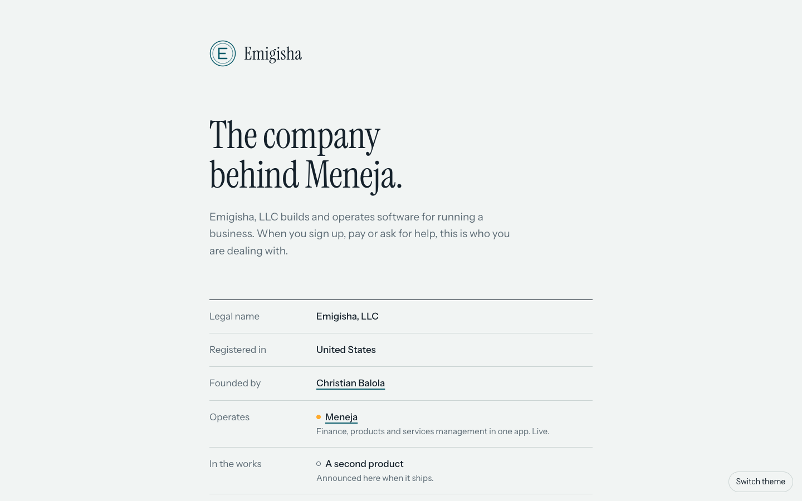
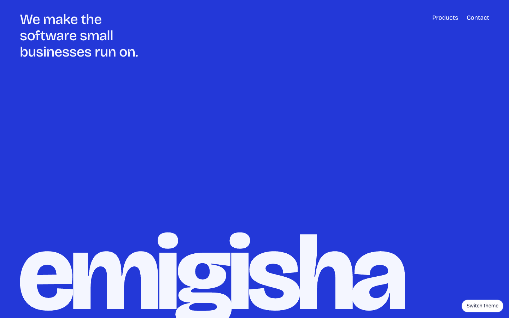
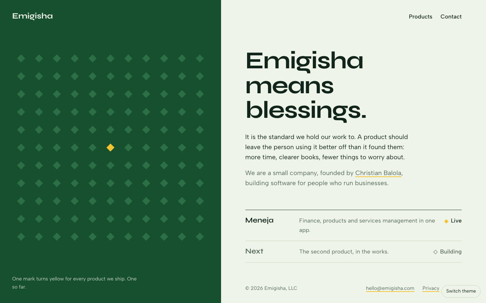
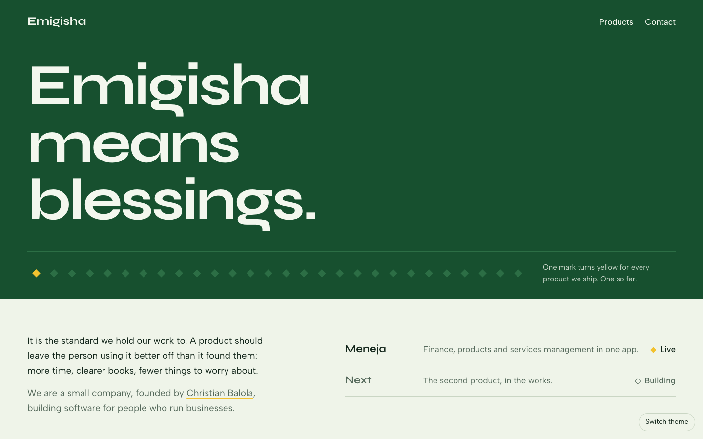
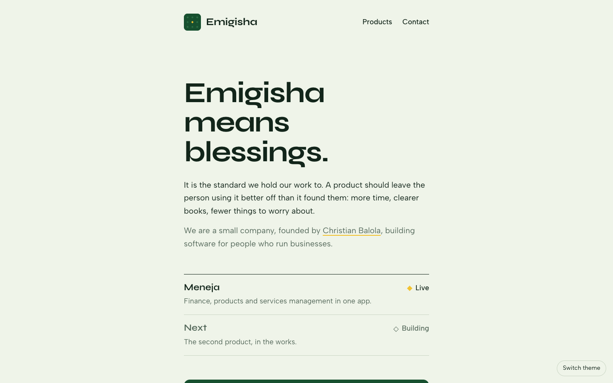
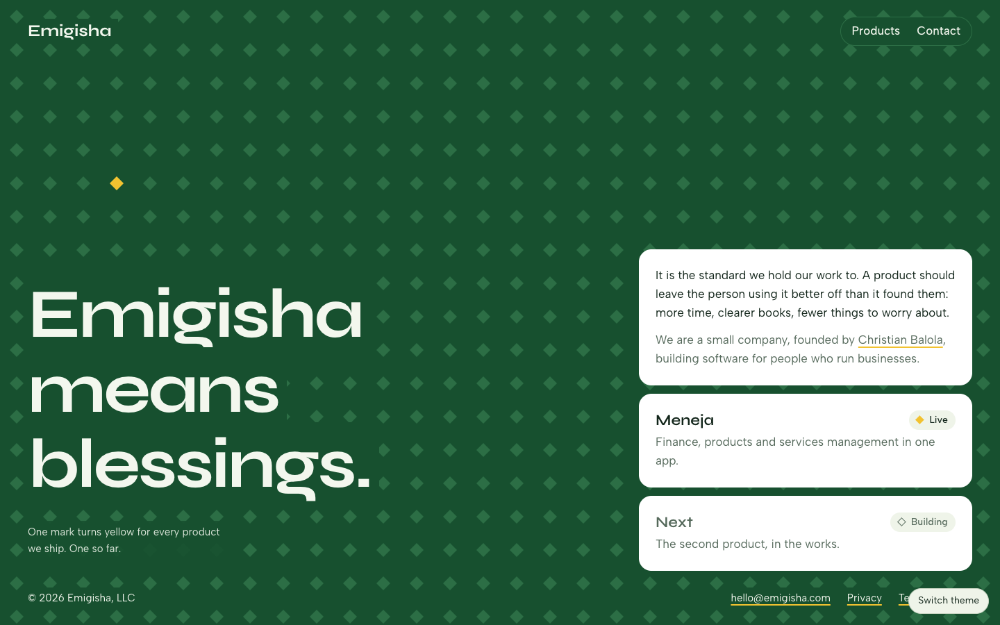
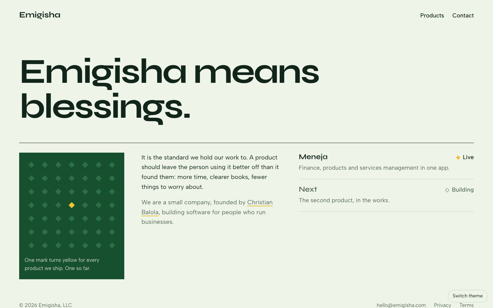

# Emigisha: brand and content proposals

Three directions. Each one is a positioning, a voice and a visual identity, shown as a one-page mockup (light and dark, desktop and phone) with screenshots in `screenshots/`. Pick one, or combine, and the build follows.

```
open apps/emigisha/docs/proposals/brand/01-imprint.html
open apps/emigisha/docs/proposals/brand/02-maker.html
open apps/emigisha/docs/proposals/brand/03-name-grid.html
open apps/emigisha/docs/proposals/brand/04-name-band.html
open apps/emigisha/docs/proposals/brand/05-name-column.html
open apps/emigisha/docs/proposals/brand/06-name-field.html
open apps/emigisha/docs/proposals/brand/07-name-sheet.html
```

Each mockup has a theme toggle in the corner and needs internet access for its fonts.

## Brief, as I read it

- Emigisha, LLC is the US company that operates Meneja. It is named in Meneja's terms and privacy pages, so customers, app stores and payment providers will look it up.
- One product today, a second in the works. The site must grow without a redesign.
- Same taste as chrisbalola.com: concise, serious, trustworthy. No testimonials, no stock illustration, no contact form.
- It needs its own identity. Amber and Manrope belong to Chris Balola and Meneja, so none of the directions use them, apart from an amber dot where Meneja is listed.

## What goes on the site (all directions)

| Item | Content |
| --- | --- |
| Wordmark | "Emigisha" |
| One-liner | What the company is, in one sentence |
| Products | Meneja (live, links to about.meneja.app), a second product marked as building |
| Company | Legal name, founder (links to chrisbalola.com) |
| Contact | One email address |
| Legal | Privacy, terms |

## A: The Imprint

`01-imprint.html`



- Positioning: the operator of record. "The company behind Meneja."
- Voice: third person, factual, no adjectives.
- Identity: cool paper `#F1F4F3`, ink `#15212B`, seal teal `#0B5D6B`. Instrument Serif for the wordmark and headline, Instrument Sans for text. A round seal with an E as the mark.
- Memorable element: the company particulars table. Every row is a fact someone came to check.
- Why it fits: it answers the question visitors actually have (who is behind this product, and are they real). Lowest risk, fastest to build, and a new product is one more row.
- Risks: says nothing about ambition. It reads as a legal entity, which is accurate today but may undersell it later.

## B: The Maker

`02-maker.html`



- Positioning: a product company. "We make the software small businesses run on."
- Voice: first person plural, plain and direct.
- Identity: cobalt `#2338D8` as a full field, white, deep navy ink `#0E1433`. Bricolage Grotesque only. The lowercase wordmark set as large as the screen allows.
- Memorable element: the wordmark filling the bottom of a blue screen.
- Why it fits: the most recognisable of the three, and it gives Emigisha a face of its own, clearly separate from Meneja's amber. Products sit below as large rows, so it scales.
- Risks: the loudest. With one product, a statement this big has to be carried by Meneja alone. The tagline also commits the company to small-business software.

## C: The Name

`03-name-grid.html` (layout 1 of 5; the others are further down)



- Positioning: the name as the standard. "Emigisha means blessings."
- Voice: first person plural, warm, a little personal.
- Identity: leaf green `#17502F`, sun yellow `#F2C230`, pale green page `#EFF4E9`. Syne for display, Albert Sans for text. A grid of diamonds as the mark.
- Memorable element: the grid. One diamond turns yellow for each product shipped, so the page records progress without a word.
- Why it fits: it is the only direction that no other company could use, and it explains a name most visitors will not know.
- Risks: it depends on the meaning being right and on you wanting it public. It is the least corporate of the three, which a bank or payment reviewer may read as less formal.

## Decision (14 Nov 2026)

Direction C, the Name, in layout 2, the Band (`04-name-band.html`). Content, colours and typefaces (Syne, Albert Sans) as in the mockup. The app in `apps/emigisha` is built from it; a few changes are planned later.

## Layouts for C

Same copy, same palette, same type in all five. Only the arrangement and the UI treatment change.

| | File | Arrangement | Diamonds | Products |
| --- | --- | --- | --- | --- |
| 1 | `03-name-grid.html` | Split: sticky green panel left, story right | 11 by 11 grid filling the panel | Rows |
| 2 | `04-name-band.html` | Green band on top with a very large headline, two columns below | One row across the page, read as a track | Rows |
| 3 | `05-name-column.html` | One narrow column, like the Letter on chrisbalola.com | Small logo tile, plus a green tally card after the products | Stacked rows |
| 4 | `06-name-field.html` | Whole page is the green field, headline bottom left, content in white cards on the right | The page background | Cards with status pills |
| 5 | `07-name-sheet.html` | Headline across the full width, then three columns: grid tile, story, products | 7 by 7 tile in the first column | Stacked rows |







- 1, Split: the grid gets the most room and stays in view while the right side scrolls. Half the screen is mostly empty marks while there is one product.
- 2, Band: the headline is the hero and the track shows progress at a glance. The grid becomes a line, so it loses some presence.
- 3, Column: the calmest and the closest sibling to chrisbalola.com. The least distinctive.
- 4, Field: the most immersive, and the only one with cards and pills. Fits one screen on desktop. The pattern behind text needs care for legibility.
- 5, Sheet: the most information on one screen, in a pale page with green as an accent. Reads more like a document than a brand.

## Open questions

1. What does "Emigisha" mean, and in which language? Direction C assumes "blessings".
2. Is Emigisha a software company only, or will it hold the other ventures too? All three directions assume software only.
3. Which domain and contact address? The mockups use `hello@emigisha.com` as a placeholder.
4. State of registration to show (the mockups say "United States").
5. Languages: English only, or English, French and Swahili like the other sites?
