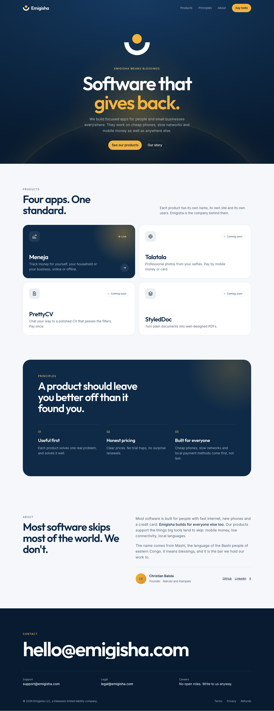
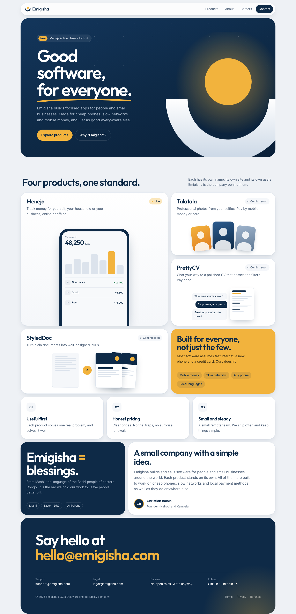
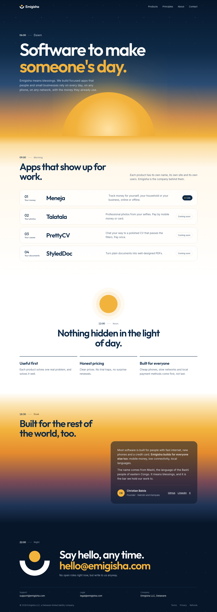
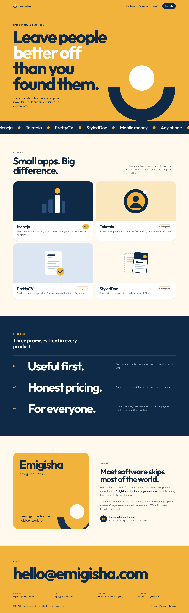
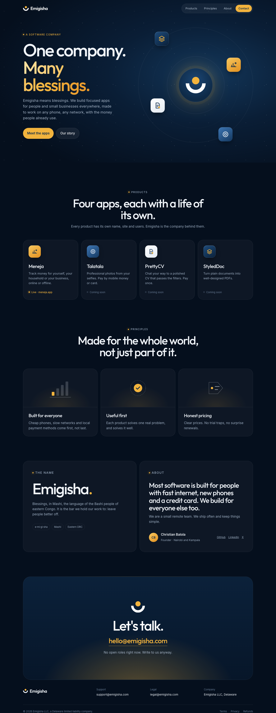
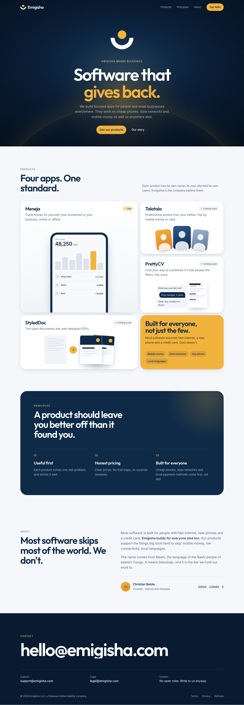

# Emigisha: website proposals

Seven concepts for a new emigisha.com, built on the chosen logo (concept P, "Full bowl", set in Outfit). Each is a working one-page mockup with light and dark themes and a phone layout, and screenshots are in `screenshots/`.

```
open apps/emigisha/docs/proposals/website/01-sunrise.html
open apps/emigisha/docs/proposals/website/02-definition.html
open apps/emigisha/docs/proposals/website/03-horizon.html
open apps/emigisha/docs/proposals/website/04-day.html
open apps/emigisha/docs/proposals/website/05-gold.html
open apps/emigisha/docs/proposals/website/06-orbit.html
open apps/emigisha/docs/proposals/website/07-sunrise-orbit.html
```

Each mockup has a light and dark toggle in the corner, and needs internet access for its fonts. Add `?theme=dark` or `?theme=light` to the URL to pick a theme.

## Shared across all seven

- Identity: navy `#0E2A47`, gold `#F2B33D`, Outfit for headings, Inter for text, the Full bowl symbol.
- Content from `website.md`: products (Meneja live; Talatala, PrettyCV and StyledDoc coming soon), principles, about, founder, contact addresses, careers line, legal line with the Delaware LLC name, and links to Terms, Privacy and Refunds (the items payment reviewers check).
- One page with anchors. Legal pages are separate and not mocked here.

## A: Sunrise

`01-sunrise.html`



- Idea: the logo comes to life. On load, the sun drops into the bowl under a soft gold glow, with a faint horizon arc behind it.
- Headline: "Software that gives back."
- Sections: navy hero, product cards (Meneja as the navy featured card), principles in a navy band, about with the founder, and a large email address in the footer.
- Best at: emotion and polish. It feels like a well-funded product company from the first second.
- Risk: the most conventional structure of the three. Its personality depends on the hero.

## B: Definition

`02-definition.html`


- Idea: the home page is a dictionary entry. "emigisha" set huge across the page, ending in the gold sun as its full stop, with three senses below: 1. Blessings. 2. The company. 3. The standard its products are held to.
- Sections: the entry, a numbered product index (rows turn navy on hover), principles numbered i, ii, iii, a short founder letter with a highlighted line, and the email as the sign-off.
- Best at: being memorable and owning the name. No other company could use this page. Warm paper background, editorial and quiet.
- Risk: the least "product" of the three. No product visuals, so it relies on typography and copy.

## C: Horizon

`03-horizon.html`



- Idea: a bento grid. The symbol is drawn huge as a sunrise over the bowl in a rounded navy hero, and each product gets its own tile with a small drawn illustration of what it does (Meneja's money screen, Talatala's portraits, PrettyCV's chat turning into a CV, StyledDoc's plain page becoming a designed one).
- Headline: "Good software, for everyone."
- Sections: floating pill nav, hero, product bento with a gold "Built for everyone" tile, three principle tiles, a navy "Emigisha = blessings." tile next to the about text, and a navy contact card.
- Best at: showing what the company actually makes. The most modern and the most catchy at a glance.
- Risk: the most to maintain. Each new product needs an illustration, and the product drawings must stay true to the real apps.

## D: Day

`04-day.html`



- Idea: the page is one day, from dawn to night. Each section is a time of day (06:00 Dawn, 09:00 Morning, 12:00 Noon, 18:30 Dusk, 22:00 Night), and the background moves from a starry sky through sunrise, daylight and sunset back to night. A gold dot on a rail at the left tracks the time as you scroll.
- Headline: "Software to make someone's day." A huge sun rises out of the horizon behind it.
- The logo's story is told by the page itself: the sun rises at the top and, at night, sits in the bowl next to the email.
- Best at: catchiness and storytelling. The most cinematic of the six.
- Risk: the gradients need care to stay legible on every screen, and the time labels are a conceit some visitors will not notice.

## E: Gold

`05-gold.html`



- Idea: bold and sunny. The hero is solid gold, with a huge four-line headline, "Leave people better off than you found them.", and the symbol drawn large with a white sun dropping into a navy bowl.
- A navy band scrolls the product names and promises (Mobile money, Any phone, Honest prices) across the page.
- Products are poster cards, each with a bold geometric drawing in the logo's style. Principles are set very large on navy. The footer is gold again, with the email filling the width.
- Best at: confidence and warmth. Unmissable, very positive, and the gold makes it unlike any other software company's site.
- Risk: the loudest. Gold at full strength over large areas needs restraint elsewhere (product sites, social posts).

## F: Orbit

`06-orbit.html` (opens in dark; the toggle switches to light)



- Idea: the company at the centre, its products in orbit. The symbol glows in the middle of a night sky and the four product icons circle it slowly on two rings.
- Headline: "One company. Many blessings."
- Sections: product cards with app icons, three principle cards with small drawings, a card for the name next to the about text, and a glowing "Let's talk." contact card.
- Best at: explaining the model (one company, many products) in a single picture. The most premium and "tech" of the six.
- Risk: the product icons are placeholders I drew; each product's real icon should replace them. The dark default is less warm than the others.

## Decision (28 Nov 2026)

G, Sunrise with the Orbit sky (`07-sunrise-orbit.html`). The site is built from it: content, palette, typefaces, hero, product bento and the neutral dark mode as in the mockup.

## Round 3: G, Sunrise with the Orbit sky

`07-sunrise-orbit.html`



A, Sunrise, kept as it is (palette, copy, sun animation, gold glow, horizon arc, principles band, footer), with three changes from your feedback:

- Hero background: the deep blue night sky with stars from F, Orbit. No gradient text.
- Products: the bento from C, Horizon, with drawings of each app.
- Dark mode: the white sections turn charcoal (`#0E1013` page, `#17191D` cards) instead of blue, so the navy hero, principles band and footer still stand out.

## Recommendation for rounds 1 and 2

C, Horizon, for the home page. It is the only one that shows the products, which is what visitors, users and payment reviewers come to see, and the bento grows with each launch. Take two things from the others: the sun-into-bowl load animation from A for the hero, and B's dictionary entry as the "Why Emigisha?" section.

If you want the calmest and most distinctive site instead, pick B.

From the second round, D is the strongest. It is the only concept where the whole page tells the logo's story (a sun rising, then settling into the bowl at night), and the most likely to be remembered and shared. Pair it with C's product tiles in the Morning section if you want both.

## Open questions

1. Meneja's status: the mockups say "Live", as on the current site. `website.md` says "Building".
2. Founder photo: the mockups use initials. A real photo would help A and C.
3. Languages: English only, or English, French and Swahili?
