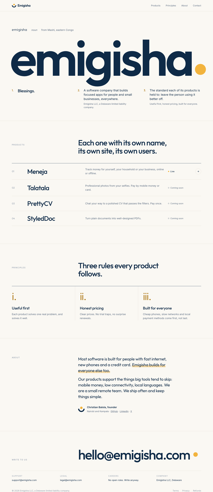

# Emigisha: website proposals

Three concepts for a new emigisha.com, built on the chosen logo (concept P, "Full bowl", set in Outfit). Each is a working one-page mockup with light and dark themes and a phone layout, and screenshots are in `screenshots/`.

```
open apps/emigisha/docs/proposals/website/01-sunrise.html
open apps/emigisha/docs/proposals/website/02-definition.html
open apps/emigisha/docs/proposals/website/03-horizon.html
```

Each mockup has a light and dark toggle in the corner, and needs internet access for its fonts. Add `?theme=dark` to the URL to open it in dark.

## Shared across all three

- Identity: navy `#0E2A47`, gold `#F2B33D`, Outfit for headings, Inter for text, the Full bowl symbol.
- Content from `website.md`: products (Meneja live; Talatala, PrettyCV and StyledDoc coming soon), principles, about, founder, contact addresses, careers line, legal line with the Delaware LLC name, and links to Terms, Privacy and Refunds (the items payment reviewers check).
- One page with anchors. Legal pages are separate and not mocked here.

## A: Sunrise

`01-sunrise.html`


- Idea: the logo comes to life. On load, the sun drops into the bowl under a soft gold glow, with a faint horizon arc behind it.
- Headline: "Software that gives back."
- Sections: navy hero, product cards (Meneja as the navy featured card), principles in a navy band, about with the founder, and a large email address in the footer.
- Best at: emotion and polish. It feels like a well-funded product company from the first second.
- Risk: the most conventional structure of the three. Its personality depends on the hero.

## B: Definition

`02-definition.html`



- Idea: the home page is a dictionary entry. "emigisha" set huge across the page, ending in the gold sun as its full stop, with three senses below: 1. Blessings. 2. The company. 3. The standard its products are held to.
- Sections: the entry, a numbered product index (rows turn navy on hover), principles numbered i, ii, iii, a short founder letter with a highlighted line, and the email as the sign-off.
- Best at: being memorable and owning the name. No other company could use this page. Warm paper background, editorial and quiet.
- Risk: the least "product" of the three. No product visuals, so it relies on typography and copy.

## C: Horizon

`03-horizon.html`


- Idea: a bento grid. The symbol is drawn huge as a sunrise over the bowl in a rounded navy hero, and each product gets its own tile with a small drawn illustration of what it does (Meneja's money screen, Talatala's portraits, PrettyCV's chat turning into a CV, StyledDoc's plain page becoming a designed one).
- Headline: "Good software, for everyone."
- Sections: floating pill nav, hero, product bento with a gold "Built for everyone" tile, three principle tiles, a navy "Emigisha = blessings." tile next to the about text, and a navy contact card.
- Best at: showing what the company actually makes. The most modern and the most catchy at a glance.
- Risk: the most to maintain. Each new product needs an illustration, and the product drawings must stay true to the real apps.

## Recommendation

C, Horizon, for the home page. It is the only one that shows the products, which is what visitors, users and payment reviewers come to see, and the bento grows with each launch. Take two things from the others: the sun-into-bowl load animation from A for the hero, and B's dictionary entry as the "Why Emigisha?" section.

If you want the calmest and most distinctive site instead, pick B.

## Open questions

1. Meneja's status: the mockups say "Live", as on the current site. `website.md` says "Building".
2. Founder photo: the mockups use initials. A real photo would help A and C.
3. Languages: English only, or English, French and Swahili?
