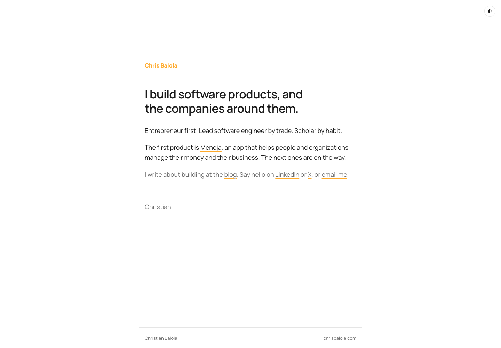
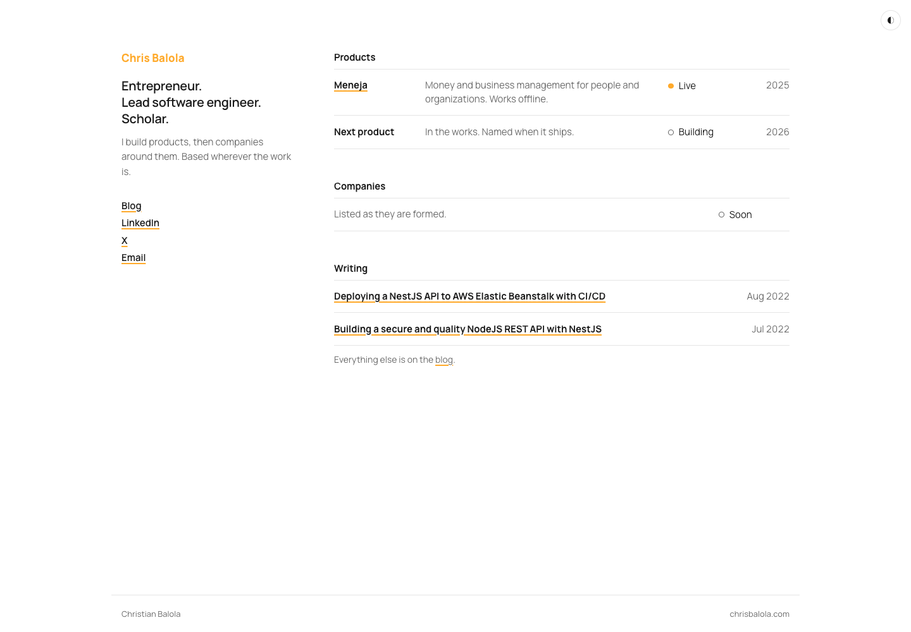
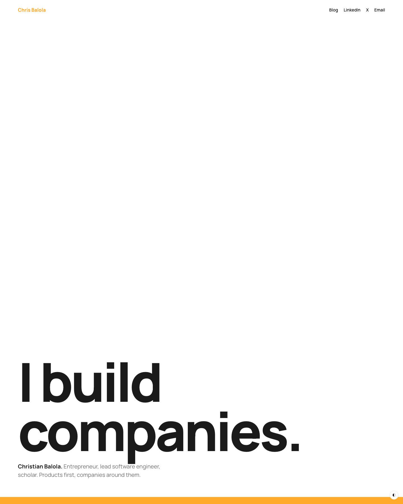
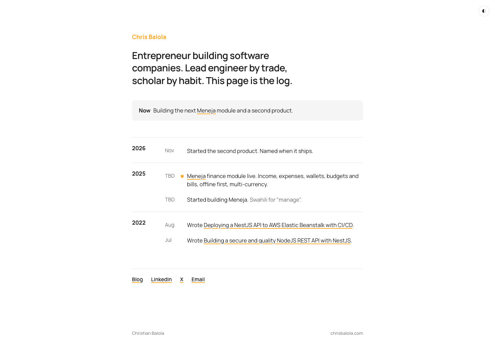
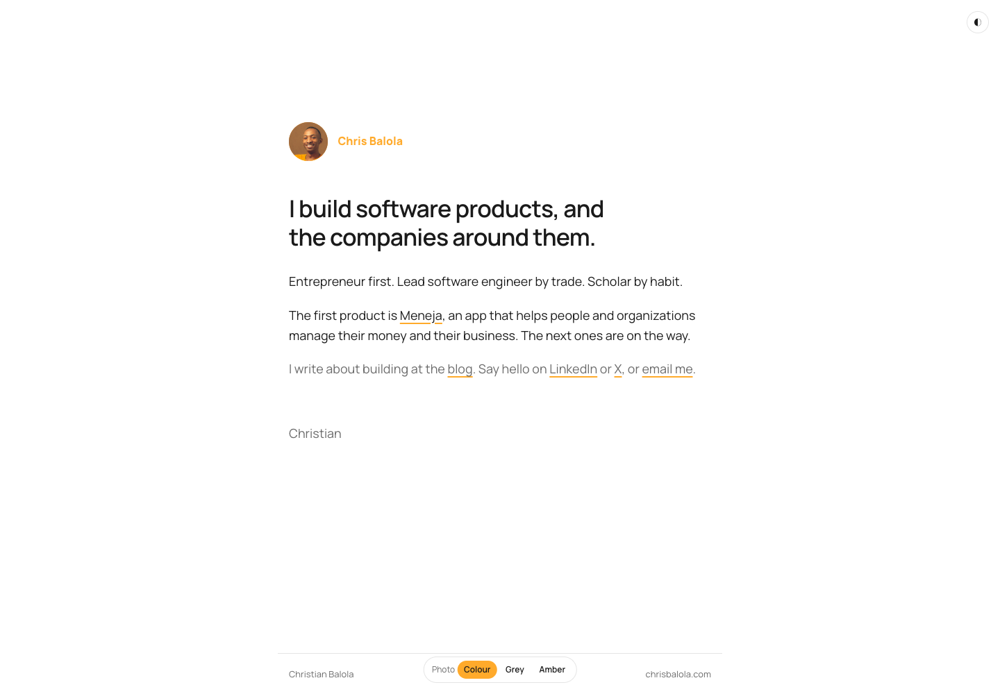
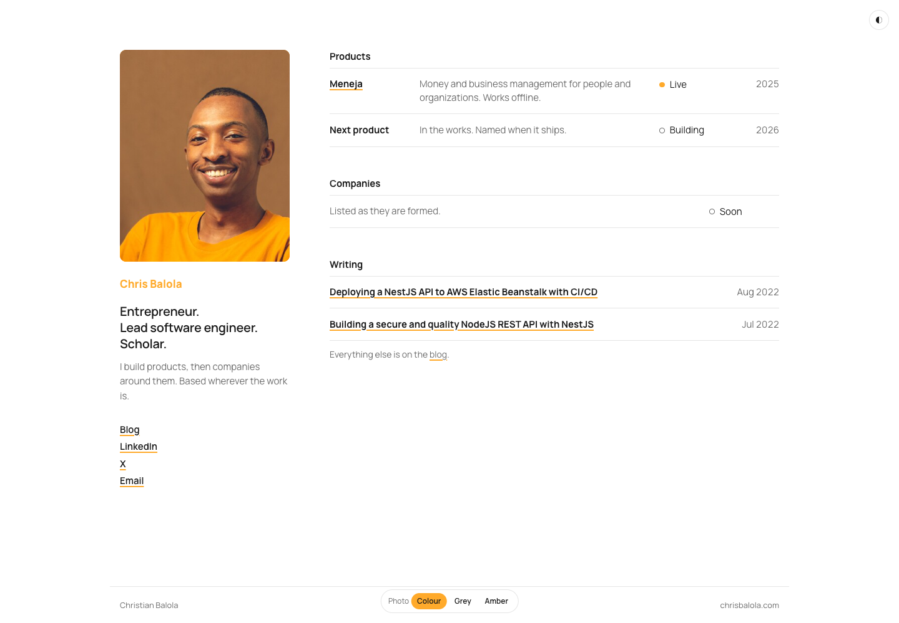
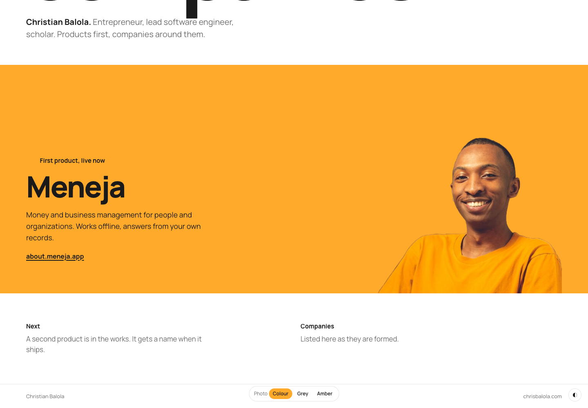
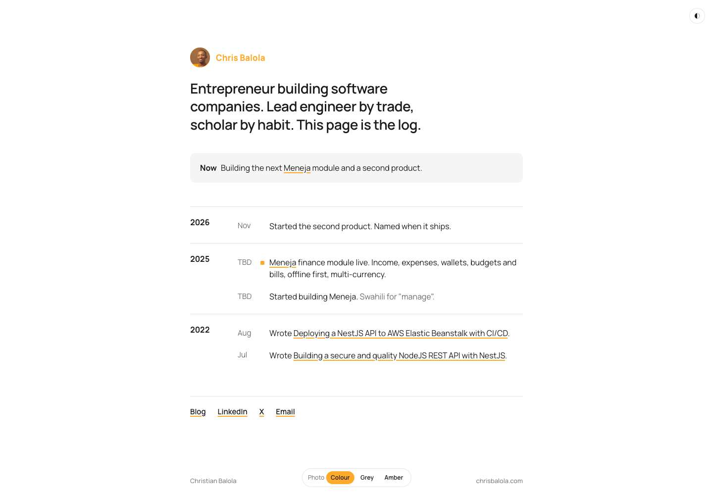

# chrisbalola.com: website proposals

Four directions for the personal site, each also offered with the photo (A2 to D2, further down). Each has a static mockup you can open in a browser (light and dark, desktop and phone) and a screenshot in `screenshots/`. Pick one, or combine, and the build follows.

```
open docs/proposals/website/01-letter.html
open docs/proposals/website/02-ledger.html
open docs/proposals/website/03-statement.html
open docs/proposals/website/04-log.html
open docs/proposals/website/05-letter-photo.html
open docs/proposals/website/06-ledger-photo.html
open docs/proposals/website/07-statement-photo.html
open docs/proposals/website/08-log-photo.html
```

Each mockup has a theme toggle in a corner. Mockups need internet access for the Manrope font.

## Brief, as I read it

- Christian Balola. Entrepreneur first, lead software engineer, scholar. Builds products, intends to build companies.
- One shipped product today (Meneja). More products soon, companies later. The site must grow without a redesign.
- Extremely concise. No skills grids, no testimonials, no "services", no contact form, no hero illustration.
- Catchy and pleasant, and it must read as serious and trustworthy.
- Existing brand: amber `#FFAA2B`, Manrope, warm minimalism, light and dark (see `docs/guide/BRAND_GUIDE.md`).

## What goes on the site (all directions)

Same content everywhere. The directions differ in how it is arranged and what carries the weight.

| Item | Content |
| --- | --- |
| Wordmark | "Chris Balola" in amber, as the brand guide already specifies |
| One-liner | Who he is and what he does, in one sentence |
| Roles | Entrepreneur, lead software engineer, scholar |
| Products | Meneja (live, link to about.meneja.app), a second product marked as in progress |
| Companies | A placeholder slot so the structure is visibly ready for them |
| Writing | Link to blog.chrisbalola.com; optionally the latest two posts |
| Elsewhere | LinkedIn, X, email |

What stays off: skill lists, CV, timeline of jobs, newsletter box, contact form, analytics widgets, "fun facts".

Rules shared by all mockups:

- Amber is used for marks only (wordmark, link underline, status dot, one slab). Never for body text on white: the contrast is too low.
- One typeface, Manrope, at two or three weights. Personality comes from size and spacing, not from a second font.
- No page-load animation. Hover and focus states only.
- Every page is a single route (`/`). Routes from the Meneja copy (`/pricing`, `/privacy`, `/terms`) are removed.

## Direction A: The Letter

`01-letter.html`



One column, about 40rem wide, written like a short note and signed with a first name. The prose is the whole page: a two-line lede, three short paragraphs, links inline with amber underlines, nothing else.

```
            Chris Balola

            I build software products, and
            the companies around them.

            Entrepreneur first. Lead engineer by trade. Scholar by habit.
            The first product is Meneja, an app that ...
            I write at the blog. Say hello on LinkedIn or X.

            Christian
            ─────────────────────────────────────
            Christian Balola              chrisbalola.com
```

- Why it fits: the most concise option possible. Reads as a person, not a portfolio. Calm confidence is itself a trust signal.
- Memorable element: the amber underlines on inline links, and the signature.
- Risks: the least "catchy" at first glance. When there are five products and two companies, the paragraph becomes a list and the direction loses its shape. It would then need a Ledger-style table under the letter.
- Best for: now, with one product. Also the fastest to build.

## Direction B: The Ledger

`02-ledger.html`



A fixed left column with name, roles and links, and a right column of tables: Products, Companies, Writing. Each row has a name, a description, a status (amber dot for live, hollow dot for building) and a year. The table is the memorable thing, and it nods to what Meneja does.

```
   Chris Balola              Products
                             ────────────────────────────────────────────
   Entrepreneur.             Meneja     Money and business ...  ● Live   2025
   Lead software engineer.   Next       In the works.           ○ Building 2026
   Scholar.
                             Companies
   I build products, then    ────────────────────────────────────────────
   companies around them.    Listed as they are formed.         ○ Soon

   Blog                      Writing
   LinkedIn                  ────────────────────────────────────────────
   X                         Deploying a NestJS API ...               Aug 2022
   Email                     Building a secure NodeJS REST API ...    Jul 2022
```

- Why it fits: serious by construction. Structure encodes real information (status, year), so the hairlines earn their place. Scales best: a new product or company is one more row, and the page never changes shape.
- Memorable element: the status column. "Live" in amber is the only colour on the page besides the wordmark.
- Risks: with one product the table is short and the Companies row is an honest placeholder. Slightly cooler in tone than A.
- Best for: the next two years, as products and companies are added.

## Direction C: The Statement

`03-statement.html`



Full-viewport poster: "I build companies." in Manrope 800 at up to 12rem, pinned to the bottom of the first screen. Below it, one full-bleed amber slab for Meneja, then a quiet two-column "Next" and "Companies" section. The site spends its entire boldness budget on the headline and the slab.

```
   Chris Balola                              Blog  LinkedIn  X  Email


   I build
   companies.
   Christian Balola. Entrepreneur, lead software engineer, scholar.
   ████████████████████████████████████████████████████████████████
   ██  First product, live now      Money and business manage-  ██
   ██  Meneja                       ment for people and orgs.   ██
   ██                               about.meneja.app            ██
   ████████████████████████████████████████████████████████████████
   Next                             Companies
   A second product is coming.      Listed here as they are formed.
```

- Why it fits: the catchiest of the four by a wide margin. States the ambition (companies, not products) as the first thing anyone reads. The amber slab makes the one shipped product feel substantial.
- Memorable element: the headline. Everything else is deliberately quiet.
- Risks: a giant "I build companies." with one product and zero companies listed can read as bravado to a sceptical visitor. The headline wording matters a lot here; alternatives: "I build things that run businesses." or "Products first. Companies next." Also the heaviest visual direction, and the one that most invites later additions that would dilute it.
- Best for: when the second product or first company is real, or if you want the site to lead with ambition today.

## Direction D: The Log

`04-log.html`



The homepage is a reverse-chronological shipping log, grouped by year, with a "Now" line at the top. Launches get a small amber square. Blog posts, product starts and company formations all go in the same list.

```
   Chris Balola

   Entrepreneur building software companies.
   Lead engineer by trade, scholar by habit. This page is the log.

   ┌──────────────────────────────────────────────────────────┐
   │ Now  Building the next Meneja module and a second product │
   └──────────────────────────────────────────────────────────┘
   ────────────────────────────────────────────────────────────
   2026   Nov    Started the second product.
   ────────────────────────────────────────────────────────────
   2025   TBD  ▪ Meneja finance module live.
          TBD    Started building Meneja.
   ────────────────────────────────────────────────────────────
   2022   Aug    Wrote "Deploying a NestJS API to AWS ..."
          Jul    Wrote "Building a secure NodeJS REST API ..."
```

- Why it fits: matches the "build in public" philosophy in `docs/product/ABOUT.md`. Trust comes from a visible track record rather than claims. Concise per line, and it grows naturally.
- Memorable element: the format itself. Few personal sites are a log.
- Risks: needs maintenance; a log that stops in 2025 says the opposite of what it should. Today the log is short, and the 2022 to 2025 gap is visible. Less immediately "catchy" than C.
- Best for: if you will actually keep it updated, roughly monthly.

## With the photo: variants A2 to D2

The photo is a gift for this brand: the shirt is within a shade of the accent `#FFAA2B`, and the brown backdrop is the same warmth. So the colour photo is the on-brand version. A grey or cut-out version is offered for comparison, but in every direction colour wins, and in C2 it is the whole idea.

Each variant has a switcher at the bottom of the page to compare three treatments in place:

- Colour: the photo as shot.
- Grey: desaturated. Calmer, more "serious", but it throws away the one thing that makes the photo yours.
- Amber: grey photo blended into the accent (a duotone). Striking in B2, wrong in C2 because it greys the shirt.

Two source files, in `photo/`: `original.jpeg` (the photo as given, 512px) and `cutout.png` (background removed with macOS Vision person segmentation, no manual cleanup). 512px is enough for the avatars and the Ledger column, but not for the Statement slab on a retina screen. The original full-size photo is needed before building C2.

Rule across all four: the photo is added at the size the direction already had room for. It never pushes the type, and it never gets a frame, shadow or gradient.

### A2. The Letter, with photo

`05-letter-photo.html`



A 56px round portrait beside the wordmark, like a letterhead. The brown backdrop keeps the circle warm on both light and dark. Nothing else changes. Expression: the note now visibly comes from a person.

### B2. The Ledger, with photo

`06-ledger-photo.html`



A 4:5 portrait fills the sticky left column above the wordmark, 10px radius, the brand's base radius. The amber shirt and the amber "Live" dot are now the only two colour events on the page and they rhyme. Of the four, this is the one where the photo most increases the expression without any other change: the ledger gains a face, the face gets a ledger.

Grey and amber treatments for comparison: `screenshots/06-ledger-photo-desktop-grey.png`, `screenshots/06-ledger-photo-desktop-amber.png`.

### C2. The Statement, with photo

`07-statement-photo.html`



The cutout sits on the amber slab, bottom-aligned, so the shirt dissolves into the slab and only the face and neck read. This is the memorable image of the whole set. The hero stays type-only; the photo belongs to the product slab, which says "this is who built it" without a caption. Needs the full-resolution original and probably one pass of manual edge cleanup on the cutout.

### D2. The Log, with photo

`08-log-photo.html`



A 40px avatar beside the wordmark, the way a commit log or feed shows its author. The smallest possible addition, and the right one for a log.

### Does the photo help?

| | Without | With | Verdict |
| --- | --- | --- | --- |
| A Letter | Calm, anonymous | Calm, personal | Small gain. Optional. |
| B Ledger | Serious, cool | Serious, warm | Clear gain. Use it. |
| C Statement | Bold type | Bold type plus a face on amber | Large gain. Becomes the catchiest option by far. |
| D Log | Feed without an author | Feed with one | Small gain. Use it. |

Updated recommendation: B2 for a site that reads as serious today; C2 if you want the most memorable site and have the full-size photo. Both keep the amber shirt as the only colour on the page besides the wordmark.

## Comparison

| | A Letter | B Ledger | C Statement | D Log |
| --- | --- | --- | --- | --- |
| Concise | Best | Good | Good | Good |
| Catchy | Low | Medium | Best | Medium |
| Trust and seriousness | High | Best | Medium (depends on wording) | High (if maintained) |
| Scales to companies | Weak | Best | Good | Good |
| Maintenance | None | Low | Low | Monthly |
| Build effort | Smallest | Small | Medium | Small |

## Recommendation

Build B (Ledger) with A's lede as the left column text. It is the most serious of the four, it needs no upkeep to stay honest, and it is the only one where adding companies is a row rather than a redesign. If you want more punch on first load, C's headline can be revisited once the second product ships; the Ledger's left column is already the right place for it.

If you prefer to lead with ambition today, choose C and use a headline that is true now, such as "Products first. Companies next."

## Implementation notes (any direction)

- Single feature `features/home` with one page component under `presentation/pages/home/`. No domain or data layer: the content is static and lives in the feature's i18n file. Products and links are arrays in the translation namespace so adding one is a translation edit.
- Delete `features/landing`, `features/pricing`, `features/legal` and their routes. Keep the `[locale]` routing and next-intl as is; ship English only until there is a reason for French.
- Keep the existing theme system (light, dark, system) and the `chrisbalola-theme` storage key.
- Metadata: title "Christian Balola", description from the one-liner, Open Graph image generated from the wordmark on amber (one static PNG is enough).
- Person JSON-LD with `sameAs` for LinkedIn, X and the blog. Cheap and helps the knowledge panel.
- Keep Sentry and the DI container; they cost nothing here and match Meneja's setup.

## Open questions

1. Email address for the site (mockups use `hello@chrisbalola.com` as a placeholder).
2. Meneja dates: when it started and when the finance module went live (shown as TBD in D, and as 2025 in B).
3. Headline wording if C is chosen.
4. Whether to show the two 2022 blog posts, or only a link to the blog. Two posts from 2022 may say "inactive" more than "writer"; linking only is safer until there is newer writing.
5. Location line, if any ("Based in ...").
6. Photo: the full-resolution original (the file in `.ai/assets` is 512px). Needed for C2, nice to have for B2.
